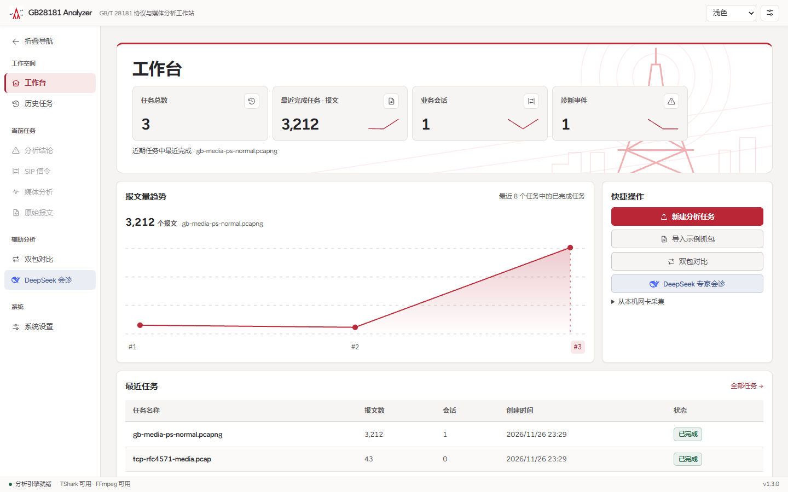
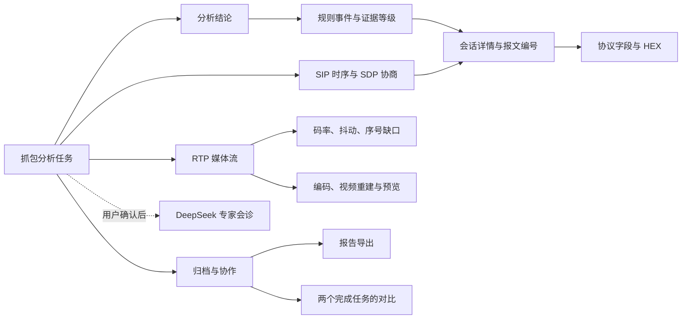
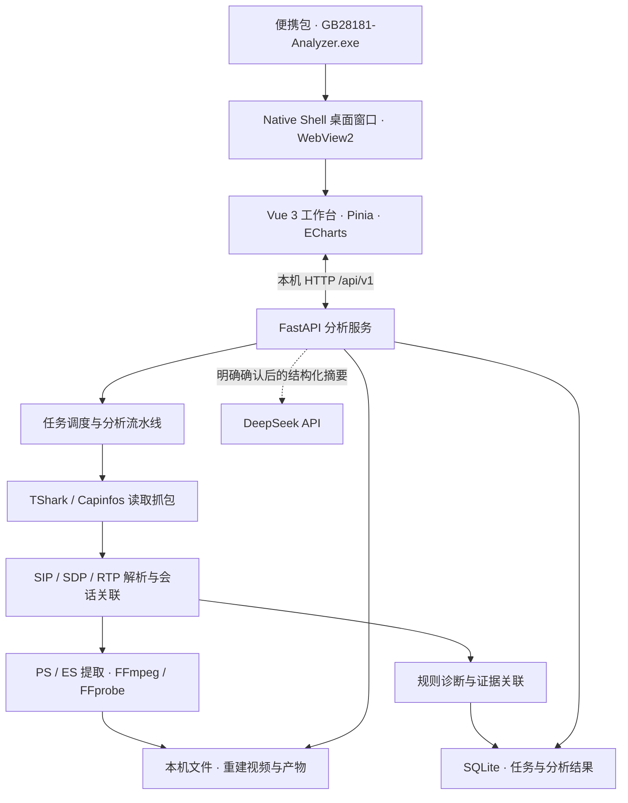

# GB28181 Analyzer

**GB/T 28181 协议与媒体分析工作站 · Windows x64 单机版**

平台返回了 SIP 200 OK，为什么预览仍然黑屏？GB28181 Analyzer 把点播信令、SDP 协商、实际捕获的媒体、重建画面和诊断证据放进同一个任务。现场工程师可以从异常结论回到具体报文，平台和设备开发人员可以对照两端抓包，交付人员可以导出可复核的报告。

**[下载 v1.4.2 Windows x64 便携包](https://github.com/CiallorZ/gb28181-analyzer/releases/download/v1.4.2/gb28181-analyzer-windows-x64-v1.4.2.zip)** · [SHA-256 校验文件](https://github.com/CiallorZ/gb28181-analyzer/releases/download/v1.4.2/SHA256SUMS.txt) · [发行说明](https://github.com/CiallorZ/gb28181-analyzer/releases/tag/v1.4.2)

*本分支运行截图。工作台的流程演示用于解释点播协议，分析页展示抓包测得的数据。*

[深色工作台](docs/screenshots/uiux/workbench-dark.png) · [全部页面双主题截图与验收记录](docs/UIUX-VALIDATION.md)

## 第一次使用

1. 在 Windows x64 上完整解压便携包，双击 `GB28181-Analyzer.exe`。程序使用 Microsoft Edge WebView2 Runtime 显示独立窗口，Windows 10/11 通常已自带；离线设备可安装微软的 Evergreen Standalone Installer。本版未签名，可用 PowerShell 的 `Get-FileHash` 与发布页的 `SHA256SUMS.txt` 核对。
2. 点击 **试用示例抓包** 熟悉工作台，或拖入自己的 PCAP、PCAPNG、CAP 文件。分析在本机完成，不上传抓包。
3. 打开 **分析结论**，选择 **查看证据**。核对关联会话、信令消息、媒体流或原始报文，再决定需要转交哪些报告和视频。

便携包内含分析服务与前端，运行时不需要 Python 或 Node.js。读取已有抓包需要 [Wireshark x64](https://www.wireshark.org/download.html)（勾选 TShark），重建画面需要 [FFmpeg](https://www.gyan.dev/ffmpeg/builds/)；缺少时仍可做信令与媒体层分析，界面会提示缺少哪一项。直接从本机网卡采集还需要 Npcap 和相应权限。

外部工具可在「设置 → 运行依赖」里逐项指定并点击“测试”验证版本，优先级为手动配置 > 环境变量 > PATH。桌面版支持“浏览”直接选择 .exe。[Windows 使用说明](docs/WINDOWS.md)

## 功能图

## 实例：从一次黑屏点播查起

| 顺序 | 在工作台上做什么 | 能回答的问题 |
| --- | --- | --- |
| 1 · 查信令 | 打开 SIP 时序，按方法筛选，点选 INVITE、响应、ACK 或 BYE，查看 Call-ID 和 CSeq。 | 当前抓包点观察到哪些请求与响应？哪一步需要检查原始报文？ |
| 2 · 查协商 | 从消息详情读 SDP，核对媒体地址、端口、传输方式与 SSRC。 | 两端在信令中协商了什么？ |
| 3 · 查媒体 | 选择关联流，对照实际端点、SSRC、码率、抖动、乱序和序号缺口。 | 在当前抓包时间窗内，观察到了什么媒体数据？ |
| 4 · 查画面 | 查看编码、分辨率、关键帧和重建状态；有重建产物时播放或下载。 | 现有媒体数据能否组成可解码的视频？ |
| 5 · 交接证据 | 从诊断事件跳到关联报文，核对协议树与 HEX，导出 Markdown、JSON、HTML 或 CSV 任务报告。 | 下一位工程师能否从同一批证据复核结论？ |

SIP 成功响应只确认相应信令事务。未捕获 RTP 时，应先核对抓包点、过滤条件和时间窗。TCP 承载 RTP 的序号缺口不能直接换算成网络丢包率。首媒体耗时与终端真正显示第一帧也有不同的测量口径。

### 设备侧与平台侧如何对比

分别导入同一次业务的两份抓包，待两个任务完成后进入 **双包对比**。先查看会话对齐方式，再检查协商、媒体、编码和诊断差异。Call-ID 相交可精确对齐，唯一业务标识可辅助推断；歧义与未对齐项单列。对比只读取入库结果，支持导出 Markdown 和 JSON 快照。任务重新分析后可查看原快照及过期提示。[对齐规则、容差和局限](docs/COMPARE.md)

### 何时使用 DeepSeek

需要整理多条证据或规划下一次现场复核时，打开任务中的专家会诊。可以选择 **综合研判、信令事务、媒体链路、现场排障**。选择专家后先看本次分析重点，再预览待发送摘要并确认。报告和后续追问支持流式输出，可使用预设问题继续核对同一任务。

AI 是可选的联网服务，发行包不提供测试 Key。用户可设置环境变量 `DEEPSEEK_API_KEY`，或在本机设置中保存自己的 Key；环境变量优先。请勿分享带密钥的应用配置。没有 Key 时，规则诊断、媒体分析和报告导出仍可使用。AI 给出的可能原因需结合报文或现场复测验证。

## 架构图

默认应用数据目录为 `%LOCALAPPDATA%\GB28181 Analyzer`。历史任务和分析产物可在重启后继续访问。清理任务前，请先导出需要留存的报告和视频；离线运行时缓存的清理方式见 Windows 使用说明。[架构与解析设计](ARCHITECTURE.md)

## 验收与适用范围

项目面向单机离线排障。已有现场验收使用 73,049 个报文的抓包，覆盖自动分析、视频播放、报文跳转和报告导出。已有性能基线中，227.72 MiB 样本分析耗时约 160 秒、峰值内存约 2.55 GiB。抓包内容、流数、磁盘性能与视频重建工作量都会影响结果。[验收与性能基线](docs/FREEZE_V1_1.md)

RTCP 已能解析 SR/RR，并用 LSR/DLSR 计算 RTT 与对端丢包、抖动；SR 时间轴尚未整体换算成墙钟时间；端点关系可供核对，多跳交互拓扑和团队数据库属于后续范围。[当前实现与已知限制](IMPLEMENTATION_STATUS.md) · [开放 Issue](https://github.com/CiallorZ/gb28181-analyzer/issues)

## 开发与维护

前端位于 `frontend/`，后端位于 `backend/`，桌面壳位于 `desktop/`，离线启动器与打包脚本位于 `scripts/offline/`。开发者可分别启动本地 API 和前端，按贡献指南执行后端 pytest 及前端 lint、Vitest、构建与体积预算检查。

[开发环境与验证命令](CONTRIBUTING.md) · [发布流程](docs/RELEASE.md) · [更新记录](CHANGELOG.md) · [MIT 许可证](LICENSE)
