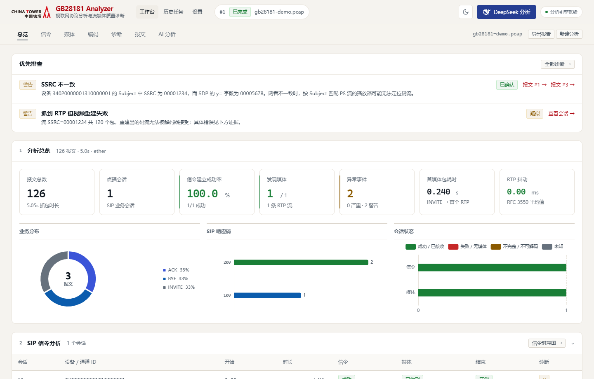
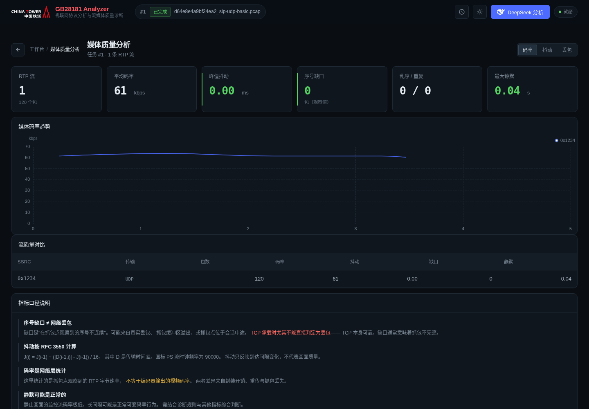
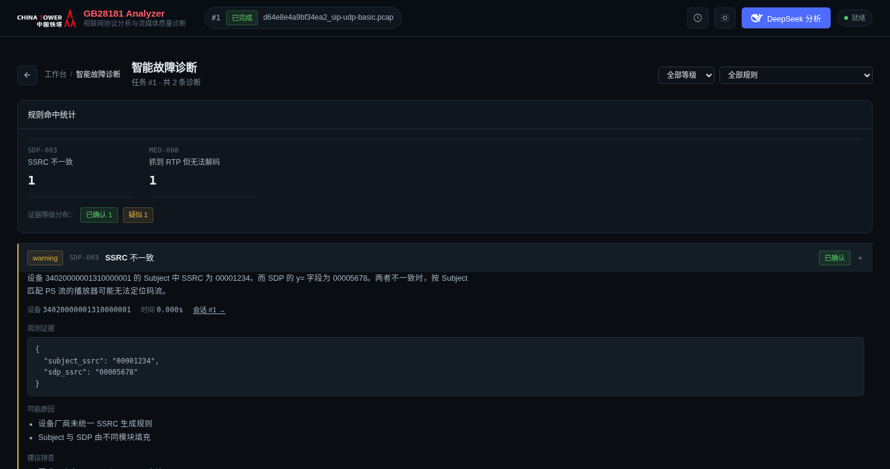
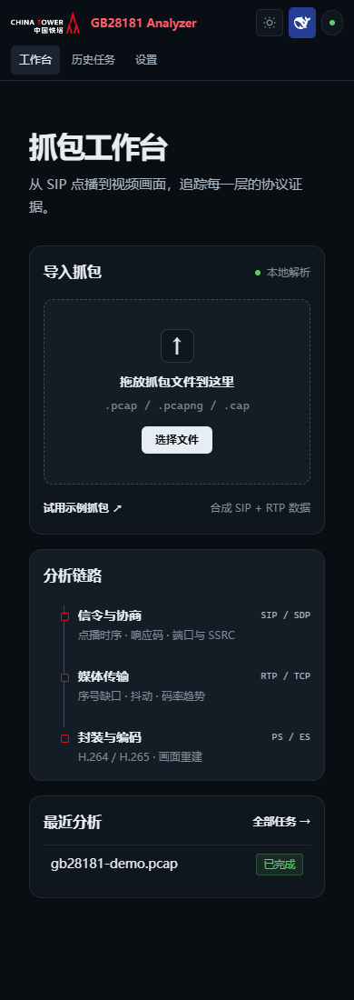

<div align="center">

# GB28181 Analyzer

**把一次国标视频点播的抓包，还原成一条能追到报文的时间线。**

上传 PCAP / PCAPNG，先回答「哪一步坏了」，再回答「为什么」。

[](https://github.com/CiallorZ/gb28181-analyzer/actions/workflows/ci.yml)
[](CHANGELOG.md)
[](LICENSE)


</div>

<picture>
  <source media="(prefers-color-scheme: dark)" srcset="docs/images/overview-dark.png">
  
</picture>

<p align="center"><sub>结果总览 · 优先排查、原始报文入口、信令与媒体状态</sub></p>

---

## 为什么是它

通用的 Wireshark 能告诉你「第 37 号包是 RTP」，但回答不了「这次点播为什么不出画面」。
GB28181 的故障往往横跨三层：SIP 协商、SDP 协商的地址与 SSRC、RTP 的实际收流。
把这三层对齐，才能把「媒体没到」和「媒体到了但解不开」区分开。

这个项目只做这一件事：**以一次业务会话为单位，给出可追溯到报文的结论**。
不做通用协议分析，不猜，不把「没抓到」说成「没发生」。

## 一次分析，回答五个问题

| 问题 | 答案在哪 |
|---|---|
| 协商成功了吗 | SIP 请求/响应、重传、Dialog 归并、关键阶段耗时 |
| 媒体到了吗 | RTP 包数、码率、RFC 3550 抖动、序号缺口、乱序、静默 |
| 能解出画面吗 | MPEG-PS → PES → ES、H.264/H.265、SPS 解析、I/P/B 帧统计 |
| 坏在哪一步 | 诊断规则命中，附证据等级、可能原因、排查建议 |
| 依据是什么 | 关联报文号、十六进制、可导出的 Markdown / JSON 报告 |

## 能力

- **信令**：SIP 请求/响应、重传识别、Dialog 归并；国标 SDP 扩展 `y=`（SSRC）、`f=`、`setup`、`xstreamtype`
- **会话**：一个 INVITE Dialog = 一次点播；`signal_status` 与 `media_status` 分开判定，不合并成「成功/失败」
- **媒体**：UDP 与 TCP（RFC 4571）承载；序号回绕、丢包、乱序、抖动、码率、静默
- **编码**：MPEG-PS → PES → ES，H.264/H.265 识别，SPS 解析，按访问单元（AU）统计 I/P/B 帧
- **还原**：参数集对齐后调用 ffmpeg 重建 MP4，浏览器内直接播放
- **诊断**：21 条规则目录，12 条已接入检测；每条带证据等级（confirmed / suspected / insufficient）、可能原因、建议、关联报文
- **报告**：单任务导出 Markdown 或 JSON，只读已入库结果，不重跑分析
- **AI**：可选接入 DeepSeek，只发送结构化摘要，不发送抓包原始字节


<p align="center"><sub><b>SIP 信令</b> · 关键阶段、交互时序、消息明细</sub></p>



<p align="center"><sub><b>媒体质量</b> · 码率、抖动、缺口，附指标口径说明</sub></p>



<p align="center"><sub><b>诊断</b> · 规则命中统计、证据等级；展开可见观测证据、可能原因与排查建议</sub></p>


<p align="center"><br><sub>窄屏工作台保留导入、示例抓包和最近任务入口</sub></p>

## 快速开始

### Windows x64

从 [GitHub Releases](https://github.com/CiallorZ/gb28181-analyzer/releases/latest) 下载 Windows x64 ZIP。安装 Wireshark 的 TShark 组件，完整解压后双击 `GB28181-Analyzer.exe`，浏览器会打开本机工作台。运行无需 Python 或 Node.js，画面重建另需 FFmpeg。详见 [Windows 使用说明](docs/WINDOWS.md)。

### Docker（推荐）

```bash
docker compose up --build
# 前端 http://localhost:8080
# 后端 http://localhost:8788 ，API 文档 /api/v1/docs
```

镜像内已装 tshark 与 ffmpeg；抓包、数据库、重建产物落在 `./data`。
对外部署时请显式设置 `ALLOWED_HOSTS`。

### 本地开发

依赖：Python 3.10+、Node.js 18+、[tshark](https://www.wireshark.org/) 4.x；
视频还原另需 ffmpeg 6.x（不装只影响播放，不影响统计）。

```bash
# 后端
cd backend
python -m venv .venv
.venv\Scripts\activate              # Linux/macOS: source .venv/bin/activate
pip install -r requirements.txt
cp .env.example .env                # 可选：端口、数据目录、外部工具路径
python -m uvicorn app.main:app --host 127.0.0.1 --port 8788 --reload
```

```bash
# 前端（另一个终端）
cd frontend
npm install
npm run dev                         # http://localhost:5173
```

前端 dev server 会把 `/api` 代理到 `127.0.0.1:8788`；生产构建用 `npm run build`，
产物在 `frontend/dist/`，交给静态服务器并反代 `/api` 即可。`npm run preview` 也带同样的代理，
可以按生产构建验收。

### 三步用起来

1. 打开工作台，拖入或选择抓包文件，点「新建分析」。
2. 等待进度完成，先看总览里的信令成功率、发现媒体数与异常事件。
3. 点开某条会话看 SDP 与 RTP 指标；在诊断页展开结论核对证据；需要留档时导出报告。

## 工作方式


分析在后台线程执行，HTTP 请求不阻塞。同一任务不能并发启动，
取消状态不会被后续进度覆盖。详细分层与数据模型见 [ARCHITECTURE.md](ARCHITECTURE.md)。

## 诊断规则

| 类别 | 规则 | 已接入 |
|---|---|---|
| 信令 SIP | 8 | 3 |
| 协商 SDP | 4 | 1 |
| 媒体 MED | 8 | 7 |
| 抓包 CAP | 1 | 1 |
| 合计 | 21 | 12 |

规则 ID 稳定可引用，例如 `SDP-003` 表示 Subject 与 SDP `y=` 的 SSRC 不一致。
未接入的 9 条在设置页明确标为「规划中」——**没报错不等于没问题**，这一点在界面上不模糊。

## 几个关键口径

**信令成功 ≠ 媒体成功。** `200 OK` 只说明协商完成。媒体是否真的到达、能否解码，单独判定；
两者分开显示，不合并成一个「成功/失败」。

**算不出来就留空。** 无法计算的指标存 `NULL`，界面显示「无法计算」或「—」，不写 0。
报告文末会声明「— 不是 0」。

**抓包点视角。** 结论只反映抓包位置观察到的流量。「没抓到」和「没发生」是两件事：
抓包截断、起点在会话中间，会以 `capture_warnings` 显式标出，不当作故障。

**TCP 被动模式的端口。** offer 里的 `m=video 8808` 是监听端口，answer 里的 `9` 是占位值。
媒体关联优先用 offer 端口，并把 0/9 视为占位，否则永远匹配不上实际连接。

**帧数按 AU 计。** 一帧通常由 SPS/PPS/SEI + 多个 slice NAL 组成，按 NAL 计数会把帧数放大数倍。
本项目按 `first_mb_in_slice == 0`（H.264）/ `first_slice_segment_in_pic_flag == 1`（H.265）切分访问单元。

## 质量与性能

| 指标 | 当前值 |
|---|---|
| 首屏同步 JS（gzip） | 90.3 KB（ECharts 改为动态 import，首屏后再加载） |
| FCP（生产构建） | 160 ms |
| 首屏预算门禁 | 110 KB，`npm run budget`，已接入 CI |
| 后端测试 | 158 passed，覆盖率 72.86%（门槛 70%） |
| 前端测试 | Vitest 7 用例；ESLint 0 error / 0 warning |
| CI | 后端 lint + test + coverage、前端 lint + test + build + budget、集成测试 |

## API

统一前缀 `/api/v1`，完整契约以运行中的 `/api/v1/docs` 为准。

| 能力 | 端点 |
|---|---|
| 上传与分析 | `POST /tasks/upload`、`GET /tasks`、`POST /tasks/{id}/analyze\|cancel` |
| 任务视图 | `GET /tasks/{id}/overview\|sessions\|diagnostics\|rule-stats\|packets` |
| 报告导出 | `GET /tasks/{id}/report?format=md\|json` |
| 会话详情 | `GET /sessions/{id}` 及 `sip\|timeline\|media\|metrics\|diagnostics` |
| 报文详情 | `GET /packets/{id}`（协议树 + 十六进制） |

## 配置

`.env`（仓库根或 `backend/` 下）或环境变量；两者同时存在时环境变量优先。

| 变量 | 默认 | 说明 |
|---|---|---|
| `HOST` / `PORT` | `127.0.0.1` / `8788` | 监听地址 |
| `DATABASE_URL` | `sqlite:///data/analyzer.db` | schema 兼容 PostgreSQL |
| `DATA_DIR` | `./data` | 上传、重建产物、数据库目录 |
| `TSHARK_PATH` / `FFMPEG_PATH` | 自动查找 | Windows 也会查 Wireshark 安装目录 |
| `MAX_CONCURRENT_TASKS` | `2` | 同时分析的任务数 |
| `REBUILD_WORKERS` | 自动 | ffmpeg 并发，默认 `min(4, 核数/2)` |
| `MAX_UPLOAD_MB` | `2048` | 单文件上传上限，超过直接拒绝 |
| `KEEP_TASKS` / `KEEP_DAYS` / `DISK_BUDGET_MB` | `5` / `7` / `2048` | 历史与磁盘保留策略 |
| `KEEP_UPLOADS` | `1` | 关掉可省空间，但不能重新分析 |
| `ALLOWED_HOSTS` / `CORS_ORIGINS` | 仅本机 | 对外部署必须显式设置 |
| `DEEPSEEK_API_KEY` | 空 | 也可在前端首次使用时配置（落盘权限 0600） |
| `AI_BASE_URL_ALLOWLIST` | `api.deepseek.com` | 允许的 AI 网关；换网关必须显式加白 |

## 部署与安全

本服务**没有账号体系**，定位是本机或可信内网的单用户工具。对外暴露前请在反向代理层加认证，
并设置 `ALLOWED_HOSTS`、透传 `Host`。上传文件按魔数校验，只读解析，不执行；
抓包原始内容不会发给 AI，也不会离开本机。

## 项目结构

```
backend/app/
  api/          tasks / sessions / diagnostics / ai
  core/         配置、数据库、安全校验
  models/       SQLAlchemy 实体
  parsers/      capture / sip_parser / session_builder / rtp_analyzer / ps_parser / rebuild
  services/     analyzer（编排）/ diagnosis（规则引擎）/ report（导出）
  schemas/      Pydantic 契约
frontend/src/
  api/ stores/ views/ utils/ styles/
data/           uploads、analyzer.db、rebuilt/（运行时生成）
docs/           ROADMAP、发布说明与抓包分析笔记
```

## 测试与检查

```bash
cd backend
pip install -r requirements-dev.txt
python -m pytest tests/ -q                      # 端到端需要 tshark，缺失时 skip
python -m pytest tests/ -q --cov=app            # 覆盖率，门槛 70%
ruff check app tests
```

```bash
cd frontend
npm run lint && npm run test && npm run build
npm run budget                                  # 首屏 JS 预算（110 KB）
```

端到端用例在 CI 的 integration job 里装上 tshark/ffmpeg 后真实执行。
测试样本与说明见 `backend/tests/fixtures/`。

## 已知限制

- 未做 RTCP 统计分析（数据模型已留位置）
- 设备拓扑只有后端数据，前端没有拓扑图
- 报告支持 Markdown / JSON；HTML 单文件与 CSV 未实现
- 上传为单请求，未做分片，上限 2 GB
- PostgreSQL 未在真实环境验证；Docker 镜像由 CI 构建，Compose 运行需在目标机器验证
- H.265 暂不区分 B 帧，非 IRAP 帧统一计入 P
- 诊断规则尚余 9 条未实现（如 REGISTER 超时、SIP 重传、码率骤降）
- 抓包缺少 SPS/PPS 时无法还原画面，只能给出编码参数缺失的诊断

路线图与优先级见 [docs/ROADMAP.md](docs/ROADMAP.md)，版本变更见 [CHANGELOG.md](CHANGELOG.md)。

## 参与开发

- API 统一 `/api/v1/` 前缀；异步任务状态可查询
- 外部程序一律列表传参，不用 `shell=True`
- 上传文件只读解析；抓包原始内容不外发
- 新解析逻辑必须配黄金值测试（固定输入 → 固定输出），避免「看起来对」的统计回归

```bash
git clone https://github.com/CiallorZ/gb28181-analyzer.git
cd gb28181-analyzer
```

## License

[MIT](LICENSE)
