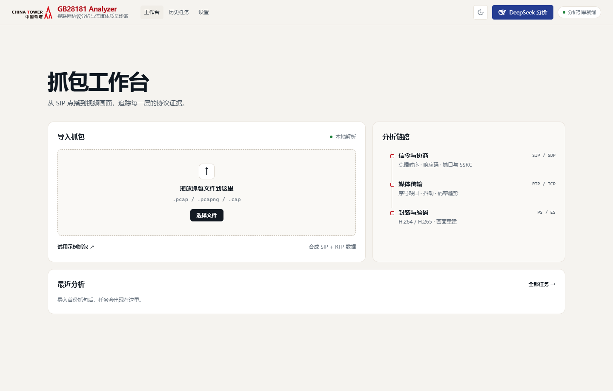
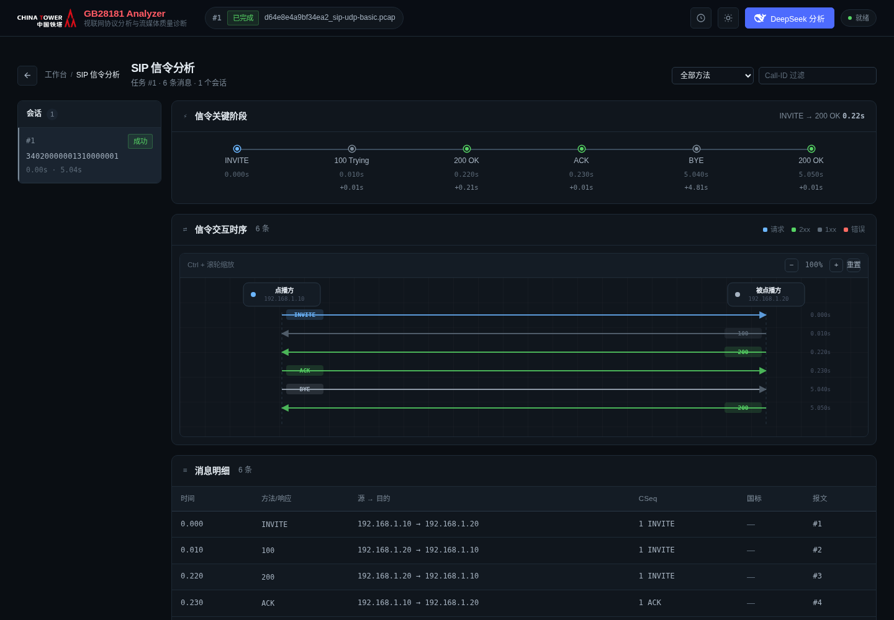

# GB28181 Analyzer

**面向 GB/T 28181 视频联网的离线抓包分析工具。** 导入一份抓包，就能沿着 SIP 信令、SDP 协商、RTP 收流和视频编码逐层定位问题。遇到「点播成功但黑屏」，可以从诊断结论跳到对应会话或原始报文核对。

[](https://github.com/CiallorZ/gb28181-analyzer/actions/workflows/ci.yml)
[](https://github.com/CiallorZ/gb28181-analyzer/releases/latest)
[](LICENSE)

**[下载 Windows x64 便携包（v1.1.2）](https://github.com/CiallorZ/gb28181-analyzer/releases/download/v1.1.2/gb28181-analyzer-windows-x64-v1.1.2.zip)** · [所有版本](https://github.com/CiallorZ/gb28181-analyzer/releases) · [Windows 使用说明](docs/WINDOWS.md)

## Windows 快速开始

1. 安装 [Wireshark x64](https://www.wireshark.org/download.html)，在安装选项中勾选 **TShark**。读取已有抓包可以跳过 Npcap。
2. 完整解压 ZIP，双击 `GB28181-Analyzer.exe`。工作台在独立桌面窗口打开，使用 Microsoft Edge WebView2 Runtime。关闭窗口即可退出。
3. 点击「试用示例抓包」，或拖入自己的 `.pcap`、`.pcapng`、`.cap` 文件。导入完成后会自动开始分析。

便携包已包含前后端运行环境，无需安装 Python 或 Node.js。需要还原视频时，将 `ffmpeg.exe` 和 `ffprobe.exe` 所在目录加入 `PATH`，重启应用后在「设置」检查工具状态。[FFmpeg Windows 构建](https://ffmpeg.org/download.html#build-windows)

Windows 版默认仅监听本机，数据保存在 `%LOCALAPPDATA%\GB28181 Analyzer`。可执行文件未做代码签名，可在发布页下载 `SHA256SUMS.txt` 核对 ZIP。

## 一次抓包怎么查

1. **先看「关键诊断」**。严重和警告事件会显示证据等级。有报文证据时可以跳到对应包号，有会话关联时可以继续查看详情。
2. **再核对信令和协商**。从 SIP 时序图查看 INVITE、响应和 ACK，核对 SDP 中的地址、端口和 SSRC。遇到 SSRC 不一致，可回到携带 Subject 和 SDP 的原始信令。
3. **最后检查媒体和画面**。查看 RTP 是否到达，以及码率、抖动、序号缺口和静默。解析出编码信息后，可查看源编码参数。成功重建的媒体流可在浏览器中播放。
4. **留档**。从工作台导出 Markdown 或 JSON 报告。报告使用已有结果，导出时无需重新分析抓包。

<picture>
  <source media="(prefers-color-scheme: dark)" srcset="docs/images/overview-dark.png">
  
</picture>

<details>
<summary>查看工作台、信令时序与媒体详情</summary>





</details>

## 两个抓包怎么对比

打开「双包对比」，选择设备侧与平台侧两个已完成任务，创建对比快照。结果页可并排核对信令、SDP、媒体、编码与诊断，筛选差异并导出 Markdown 或 JSON。低置信度与未对齐项单列标识；重新分析后仍可读取旧快照。[对齐规则、容差和快照生命周期](docs/COMPARE.md)

## 分析范围

| 层级 | 可查看的数据 |
| --- | --- |
| SIP / SDP | 请求与响应、交互时序、重传、会话阶段耗时，以及 SDP 地址、端口、传输方式和国标扩展 `y=`、`f=`。 |
| RTP | UDP 与 TCP（RFC 4571）承载的流，支持按序号回绕处理，并查看乱序、重复、缺口、抖动和码率。纯 RTP 抓包也能单独分析。 |
| PS / ES | MPEG-PS 解封装、H.264 / H.265 识别、分辨率与帧结构统计。具备解码条件时可通过 FFmpeg 重建 MP4。 |
| 诊断和报文 | 规则命中、可能原因和排查建议。诊断会标明「已确认」「疑似」或「证据不足」，并按可用证据关联报文或会话。 |

**读结果时请留意**

- SIP 响应成功、收到媒体和画面可播放是三个独立结果。判断依据来自当前抓包点及其覆盖的时间范围。
- RTP 序号缺口反映抓包中看到的缺失区间。TCP 承载的到达时间可能是估算值，抖动与丢包结论需要结合证据等级阅读。无法计算的指标显示为「—」或「无法计算」。
- 工作台趋势图展示报文量最高的 12 条媒体流，流列表仍保留其余流。桌面及支持 Web Crypto 的安全上下文中，大于 32 MiB 的文件使用 8 MiB 分片，重新选择同一文件即可续传，上限为 16 GiB。其他情况使用普通上传，默认上限 2048 MiB（MAX_UPLOAD_MB）。
- 规则引擎已接入全部 21 条规则。REGISTER 至少覆盖 32 秒观察窗口才报告未响应；同一事务同一端点方向累计出现至少四次请求提示疑似重传。码率下降需连续三个完整采样窗口不超过前三窗中位数的 30%。证据不足时仍需核对抓包范围。历史任务的诊断保留原结果，重新分析后才会应用新规则。
- 工作台支持按需查看 TShark 识别的 RTCP 接收报告块、目录层级和 SIP/RTP 端点关系；H.265 帧统计暂未细分 B 帧。

## Docker 部署

在仓库根目录启动 Docker Compose。

```bash
docker compose up --build
```

工作台位于 `http://localhost:8080`，后端 OpenAPI 文档位于 `http://localhost:8788/api/v1/docs`。镜像包含 TShark 和 FFmpeg，运行数据保存在仓库的 `data/` 目录。

应用面向本机或可信内网。服务没有账号体系，向其他网络开放时应在反向代理层配置认证，并设置 `ALLOWED_HOSTS`。抓包由运行分析服务的机器处理。主动配置并调用可选的 DeepSeek 分析前，界面会展示将发送的结构化摘要；摘要隐藏文件名、设备标识、协商地址及诊断自由描述，仍保留端口、SSRC 等字段，不能视为完全匿名。确认后才发送；追问还会发送摘要和对话内容，用户输入不会自动脱敏。摘要只列出部分会话、媒体流和诊断时会标明数量，不能代替完整抓包检查。

## 从源码运行

准备 Python 3.10+、Node.js 18+ 和 TShark。视频还原需要 FFmpeg。以下后端命令以 PowerShell 为例，Linux/macOS 可将虚拟环境内的 Python 路径换为 `.venv/bin/python`。

```powershell
cd backend
python -m venv .venv
.\.venv\Scripts\python.exe -m pip install -r requirements.txt
.\.venv\Scripts\python.exe -m uvicorn app.main:app --host 127.0.0.1 --port 8788 --reload
```

从仓库根目录打开另一个终端并启动前端。

```bash
cd frontend
npm ci
npm run dev
```

打开 `http://localhost:5173`。开发服务器会将 `/api` 转发到本机 8788 端口。要检查生产构建，可运行 `npm run build` 后执行 `npm run preview`。上传上限、历史保留和工具路径等配置见 [backend/.env.example](backend/.env.example)。

## 开发与维护

- [架构与数据流](ARCHITECTURE.md)
- [贡献指南与验证命令](CONTRIBUTING.md)
- 界面字体采用 [GoodUI Sans / Display](https://goodui.dev/fonts)，按 [OFL 1.1](frontend/public/assets/fonts/goodui/OFL.txt) 随包分发。空态、表格与对话参考其公开区块，在 Vue 中接入本项目的数据和控件。
- [当前实施状态与已知限制](IMPLEMENTATION_STATUS.md)
- [发布与 Windows 打包流程](docs/RELEASE.md)
- [测试抓包与预期结果](backend/tests/fixtures/README.md)
- [变更记录](CHANGELOG.md) · [路线图](docs/ROADMAP.md)
